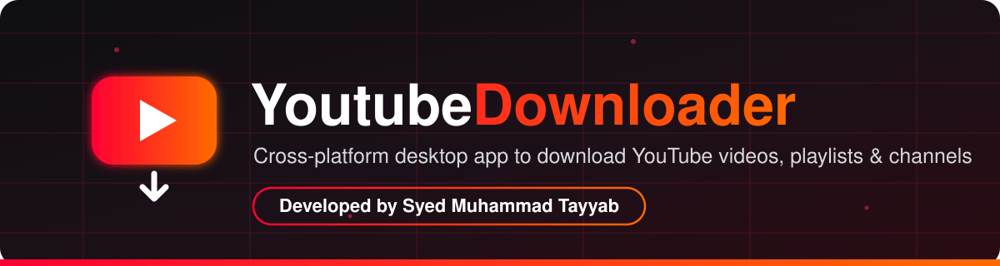
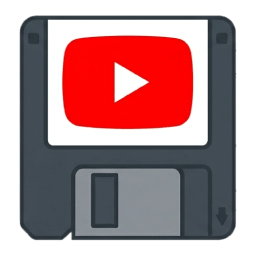
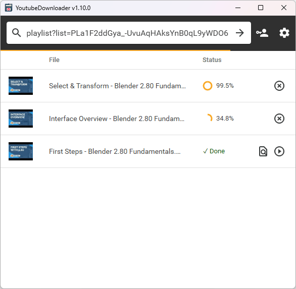
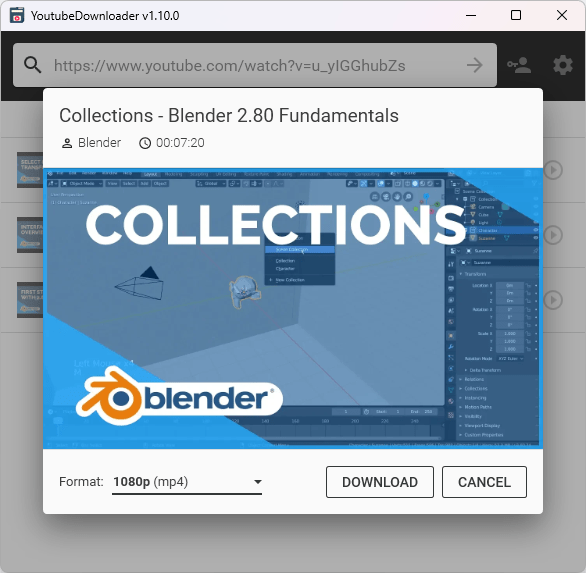
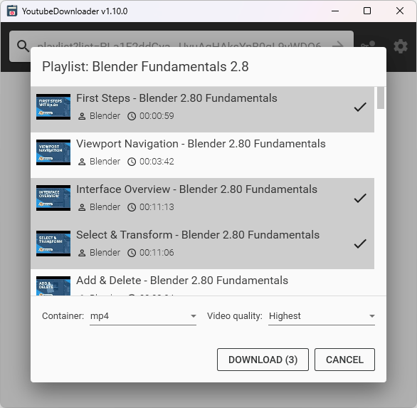
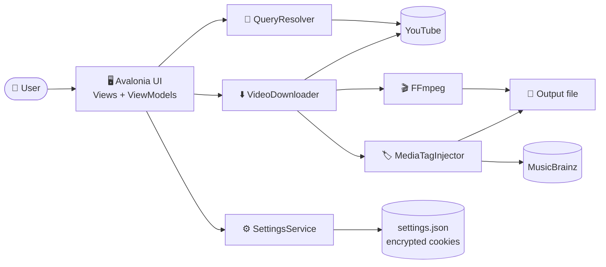
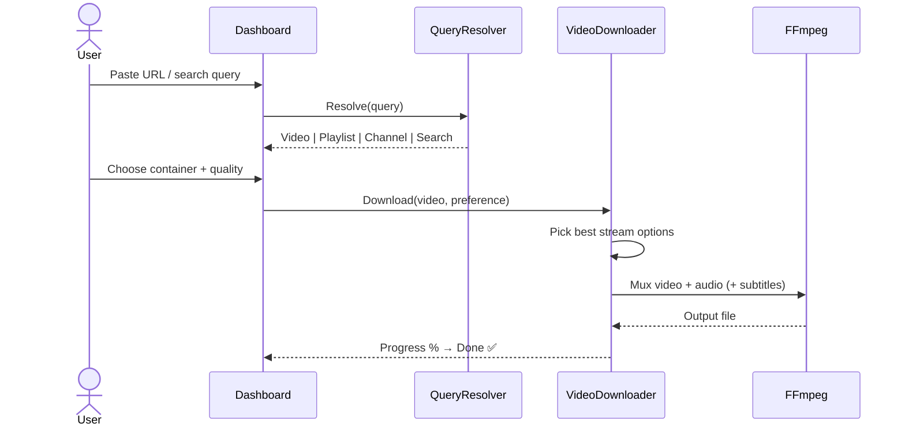
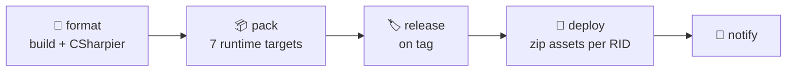

<!-- ═══════════════════════ HEADER · Developed by Syed Muhammad Tayyab ═══════════════════════ -->
<p align="center">
  
</p>

<p align="center">
  
</p>

<p align="center">
  <a href="https://github.com/Syed-Muhammad-Tayyab/YoutubeDownloader">
    
  </a>
</p>

<p align="center">
  
</p>

<p align="center">
  <a href="https://github.com/Syed-Muhammad-Tayyab/YoutubeDownloader/actions"></a>
  <a href="https://github.com/Syed-Muhammad-Tayyab/YoutubeDownloader/releases"></a>
  <a href="License.txt"></a>
  
</p>
<p align="center">
  
  
  
  
  
  
  
  
</p>
<p align="center">
  
  
  
  
</p>

<p align="center">
  <a href="#-overview"><b>Overview</b></a> ·
  <a href="#-features"><b>Features</b></a> ·
  <a href="#-screenshots"><b>Screenshots</b></a> ·
  <a href="#-tech-stack"><b>Tech Stack</b></a> ·
  <a href="#-architecture"><b>Architecture</b></a> ·
  <a href="#-getting-started"><b>Getting Started</b></a> ·
  <a href="#-faq"><b>FAQ</b></a>
</p>

<p align="center"></p>

<details>
<summary><b>📑 Table of Contents</b> (click to expand)</summary>

- [✨ Overview](#-overview)
- [🚀 Features](#-features)
- [📸 Screenshots](#-screenshots)
- [🧰 Tech Stack](#-tech-stack)
- [🏗️ Architecture](#-architecture)
- [📂 Project Structure](#-project-structure)
- [🎨 Colour Palette](#-colour-palette)
- [⚙️ How It Works](#-how-it-works)
- [📥 Download](#-download)
- [🏁 Getting Started](#-getting-started)
- [🔧 Configuration](#-configuration)
- [📦 Build & Deployment](#-build--deployment)
- [🗺️ Roadmap](#-roadmap)
- [❓ FAQ](#-faq)
- [🤝 Contributing](#-contributing)
- [⚖️ Legal Notice](#-legal-notice)
- [📜 License & Credits](#-license--credits)
- [👨‍💻 Developer](#-developer)

</details>

---

## ✨ Overview

**YoutubeDownloader** is a fast, modern, **cross-platform desktop application** that lets you download videos from YouTube.
Copy-paste the URL of any **video, playlist or channel** (or just type a **search query**) and download it directly in the **format and quality of your choice**: subtitles, alternative audio tracks and media tags included.

> 💡 **Why this project?** One clean GUI, zero command-line fiddling, and FFmpeg handled for you. It runs natively on **Windows, Linux and macOS** from a single C# codebase.

<table>
<tr>
<td align="center" width="25%"><h3>🌍</h3><b>Cross-platform</b><br/><sub>Windows · Linux · macOS<br/>x64 / ARM64</sub></td>
<td align="center" width="25%"><h3>⚡</h3><b>Parallel downloads</b><br/><sub>Configurable concurrency<br/>with live progress</sub></td>
<td align="center" width="25%"><h3>🎞️</h3><b>Rich media</b><br/><sub>Subtitles, multi-language<br/>audio &amp; tags embedded</sub></td>
<td align="center" width="25%"><h3>🌐</h3><b>Localized</b><br/><sub>9 UI languages<br/>light &amp; dark themes</sub></td>
</tr>
</table>

---

## 🚀 Features

| | Feature | Description |
|---|---|---|
| 🖥️ | **Cross-platform GUI** | Native desktop UI built with Avalonia and Material design |
| 🔗 | **Download by URL** | Paste any video link or ID |
| 📃 | **Playlists & channels** | Resolve and queue an entire playlist or channel's uploads |
| 🔍 | **Search queries** | Type keywords instead of a URL to search videos |
| 🎚️ | **Quality & format** | Lowest, ≤360p, ≤480p, ≤720p, ≤1080p or Highest, in your preferred container (e.g. MP4) |
| 🔊 | **Alternative audio tracks** | Automatically embed language-specific audio streams |
| 💬 | **Subtitles** | Automatically embed available subtitles |
| 🏷️ | **Media tags** | Inject title/artist tags (with MusicBrainz lookup) via TagLib |
| 🔐 | **Account login** | Sign in with a YouTube account (embedded WebView) to access private content, cookies stored encrypted |
| 📝 | **File name templates** | `$title`, `$author`, `$id`, `$uploadDate`, `$num`, `$numc` |
| ⏭️ | **Skip existing files** | Avoid re-downloading what you already have |
| 🔄 | **Auto-update** | Built-in updater powered by Onova |
| 🎨 | **Themes** | System / Light / Dark |
| 🌐 | **Localization** | English, Ukrainian, German, French, Spanish, Chinese (Simplified), Hungarian, Korean + system default |

---

## 📸 Screenshots

<p align="center">
  
  
  
</p>
<p align="center"><sub><b>Download queue</b> · <b>Single video</b> · <b>Playlist / multiple videos</b></sub></p>

---

## 🧰 Tech Stack

| Layer | Technology | Purpose |
|---|---|---|
| **Language** |  | Entire codebase |
| **Runtime** |  | Self-contained cross-platform builds |
| **UI** | Avalonia 12 · Material.Avalonia · Material.Icons · DialogHost | Desktop UI, theming, dialogs |
| **MVVM** | CommunityToolkit.Mvvm · Microsoft.Extensions.DependencyInjection | View-models and services |
| **YouTube engine** | YoutubeExplode · YoutubeExplode.Converter | Query resolving, stream manifests, muxing |
| **Media** | FFmpeg 8.1 · TagLibSharp | Merge streams, tag files |
| **Auth** | Avalonia.Controls.WebView | In-app YouTube sign-in |
| **Settings** | Cogwheel · PowerKit | Persistent JSON settings |
| **Updates** | Onova | Auto-update |
| **Markdown** | Markdig | Rich text in dialogs |
| **Quality** | CSharpier · TreatWarningsAsErrors · Dependabot | Formatting and dependency hygiene |
| **CI/CD** | GitHub Actions | Format check, 7-target publish, auto-release |

---

## 🏗️ Architecture





---

## 📂 Project Structure

```text
📦 YoutubeDownloader
├── 📁 .assets/                    🖼️ screenshots
├── 📁 .devcontainer/              🐳 DevContainer (desktop-lite + CSharpier)
├── 📁 .github/
│   ├── 📁 ISSUE_TEMPLATE/         🐞 bug + feature forms
│   ├── 📁 workflows/main.yml      🤖 format → pack → release → deploy → notify
│   ├── 📄 dependabot.yml          🔄 monthly NuGet + Actions updates
│   ├── 📄 release.yml             🗒️ changelog categories
│   └── 📄 PULL_REQUEST_TEMPLATE.md
├── 📁 docs/assets/                🎨 banner + divider SVGs
├── 📁 YoutubeDownloader/          🖥️ Avalonia desktop app
│   ├── 📁 Converters/             🔁 XAML value converters
│   ├── 📁 Framework/              🧱 base view/view-model, dialogs, snackbar, theme
│   ├── 📁 Localization/           🌐 9 languages
│   ├── 📁 Services/               ⚙️ settings + updates
│   ├── 📁 Utils/                  🛠️ extensions + native methods
│   ├── 📁 ViewModels/             🧠 Components + Dialogs
│   ├── 📁 Views/                  🪟 Components + Dialogs (.axaml)
│   ├── 📄 App.axaml(.cs)
│   └── 📄 Program.cs
├── 📁 YoutubeDownloader.Core/     🧩 UI-independent core library
│   ├── 📁 Downloading/            ⬇️ downloader, FFmpeg, templates, preferences
│   ├── 📁 Resolving/              🔎 query resolver + result types
│   ├── 📁 Tagging/                🏷️ TagLib + MusicBrainz
│   └── 📁 Utils/                  🌐 HTTP client, thumbnail helpers
├── 📄 YoutubeDownloader.slnx
├── 📄 Directory.Build.props / Directory.Packages.props
├── 📄 global.json                 📌 .NET SDK 10
├── 📄 Contributing.md · CODE_OF_CONDUCT.md · SECURITY.md
├── 📄 License.txt                 ⚖️ MIT
└── 📄 README.md                   📖 you are here
```

---

## 🎨 Colour Palette

| Swatch | Name | Hex | Used for |
|---|---|---|---|
|  | **Signal Red** | `#FF0033` | Primary accent, banner, badges |
|  | **Ember Orange** | `#FF6A00` | Gradient end, highlights |
|  | **Night** | `#0F0F13` | Banner background |
|  | **Crimson Night** | `#2A0B12` | Banner gradient |
|  | **Snow** | `#FFFFFF` | Text |

---

## ⚙️ How It Works

<details>
<summary><b>1️⃣ Resolving your query</b></summary>

`QueryResolver` tries the input against, in order, playlist ID, video ID, channel (ID / handle / username / slug) and finally falls back to a search. Results come back as a typed `QueryResult` (`Video`, `Playlist`, `Channel`, `Search`, `Aggregate`). Personal system playlists (Watch Later, Liked, etc.) are only resolved when you are signed in.

</details>

<details>
<summary><b>2️⃣ Choosing what to download</b></summary>

The setup dialogs let you pick a **container** and a **`VideoQualityPreference`** (`Lowest`, `UpTo360p`, `UpTo480p`, `UpTo720p`, `UpTo1080p`, `Highest`). `VideoDownloader` turns that into the best matching stream combination.

</details>

<details>
<summary><b>3️⃣ Downloading & muxing</b></summary>

Streams are fetched through **YoutubeExplode** and merged by **FFmpeg**. If FFmpeg isn't found next to the app, in the working directory or on your `PATH`, the app downloads a matching build for you. Optional extras (alt-language audio, subtitles, tags) are injected in the same pass.

</details>

<details>
<summary><b>4️⃣ File naming</b></summary>

Name output files with a template. Supported tokens:

| Token | Meaning |
|---|---|
| `$title` | Video title (default) |
| `$author` | Channel name |
| `$id` | Video ID |
| `$uploadDate` | `yyyy-MM-dd` |
| `$num` | Position in a batch, as `[1]` |
| `$numc` | Position in a batch, bare |

Example: `$author - $title` → `Some Channel - Some Video.mp4`. Invalid file-name characters are escaped automatically.

</details>

<details>
<summary><b>5️⃣ Authentication</b></summary>

Sign in through an embedded WebView to reach private or age-restricted content you have access to. Cookies are **encrypted** before being written to the settings file, and persistence can be switched off in Settings.

</details>

---

## 📥 Download

| Platform | Architectures |
|---|---|
| 🪟 **Windows** | `win-x64` · `win-x86` · `win-arm64` |
| 🐧 **Linux** | `linux-x64` · `linux-arm64` |
| 🍎 **macOS** | `osx-x64` (Intel) · `osx-arm64` (Apple Silicon) |

👉 Grab the latest build from **[Releases](https://github.com/Syed-Muhammad-Tayyab/YoutubeDownloader/releases/latest)** or a CI build from **[Actions](https://github.com/Syed-Muhammad-Tayyab/YoutubeDownloader/actions/workflows/main.yml)**.

> [!NOTE]
> Unsure which build fits your machine? Check your OS and CPU at [useragent.cc](https://useragent.cc).

> [!IMPORTANT]
> **macOS:** unsigned apps are quarantined. After unzipping run:
> ```bash
> xattr -rd com.apple.quarantine YoutubeDownloader.app
> ```

---

## 🏁 Getting Started

### Prerequisites

- [.NET SDK 10](https://dotnet.microsoft.com/download) (pinned in `global.json`)
- Git
- *(optional)* VS Code + [Dev Containers](https://containers.dev) for a ready-made environment

### Clone & run

```bash
# 1. Clone
git clone https://github.com/Syed-Muhammad-Tayyab/YoutubeDownloader.git
cd YoutubeDownloader

# 2. Restore & build
dotnet build

# 3. Run the desktop app
dotnet run --project YoutubeDownloader
```

### Using the app

1. Paste a **video / playlist / channel URL**, or type a **search query**, then press <kbd>Enter</kbd>
2. Pick **container** and **quality**
3. Choose the videos you want (for playlists) and confirm
4. Watch progress in the queue, then open the file or its folder when it's **Done ✅**

### 🐳 Dev Container

Open the folder in VS Code → **Reopen in Container**. A virtual desktop is exposed at <http://localhost:6080> so you can see the Avalonia window from inside the container.

---

## 🔧 Configuration

Available from the ⚙️ **Settings** dialog:

| Setting | Default | Description |
|---|---|---|
| Theme | System | System / Light / Dark |
| Language | System | 9 supported UI languages |
| Auto-update | On | Check for new releases |
| Persist authentication | On | Keep encrypted login cookies |
| FFmpeg path | Auto | Custom FFmpeg location |
| Inject audio languages | On | Embed alt-language audio |
| Inject subtitles | On | Embed subtitles |
| Inject tags | On | Write media tags |
| Skip existing files | Off | Don't re-download |
| File name template | `$title` | See tokens above |
| Parallel limit | `2` | Simultaneous downloads |

---

## 📦 Build & Deployment

The workflow in [`.github/workflows/main.yml`](.github/workflows/main.yml) runs on pushes to `prime`, tags and pull requests:



Publish a self-contained build locally:

```bash
dotnet publish YoutubeDownloader \
  --configuration Release \
  --runtime win-x64 \
  --self-contained \
  --output YoutubeDownloader/bin/publish
```

Swap `win-x64` for any of `win-x86`, `win-arm64`, `linux-x64`, `linux-arm64`, `osx-x64`, `osx-arm64`.

**To cut a release:** push a tag (`git tag v1.0.0 && git push --tags`). The workflow builds all targets, creates the GitHub release with generated notes and uploads one zip per platform.

---

## 🗺️ Roadmap

- [x] Video / playlist / channel / search resolving
- [x] Quality + container selection
- [x] Subtitles, alt-language audio and media tags
- [x] YouTube account login
- [x] 9 languages, light/dark themes
- [x] Cross-platform CI with auto-release
- [ ] Download history view
- [ ] Audio-only presets (MP3 / M4A / Opus)
- [ ] Pause & resume downloads
- [ ] Scheduled / queued batch downloads
- [ ] More UI languages

> Have an idea? [Open a feature request](https://github.com/Syed-Muhammad-Tayyab/YoutubeDownloader/issues/new/choose) 💬

---

## ❓ FAQ

<details>
<summary><b>Do I need to install FFmpeg?</b></summary>
No. The app looks for it next to the executable, in the working directory and on <code>PATH</code>, and downloads one if missing. You can also point to your own in Settings.
</details>

<details>
<summary><b>Can I download private videos?</b></summary>
Only ones your own account can access: sign in via the key icon in the search bar.
</details>

<details>
<summary><b>Is my login safe?</b></summary>
Cookies are encrypted in the settings file, and you can disable persistence entirely in Settings.
</details>

<details>
<summary><b>Why does macOS say the app is damaged?</b></summary>
It isn't notarized. Run <code>xattr -rd com.apple.quarantine YoutubeDownloader.app</code> once.
</details>

<details>
<summary><b>A download fails, what now?</b></summary>
YouTube changes often. Update the app to the newest release (YoutubeExplode is updated regularly), then open an issue with logs if it persists.
</details>

---

## 🤝 Contributing

Contributions are welcome! 🎉

1. 🍴 Fork the repo
2. 🌿 Create a branch: `git checkout -b feature/amazing`
3. 💾 Commit: `git commit -m "feat: add amazing"`
4. 📤 Push and open a Pull Request against `prime`

Read [Contributing.md](Contributing.md) and the [Code of Conduct](CODE_OF_CONDUCT.md) first. Security issues → [SECURITY.md](SECURITY.md).

---

## ⚖️ Legal Notice

This tool is intended for downloading content you own, that is in the public domain / openly licensed, or that you otherwise have the right to save. Downloading may violate YouTube's Terms of Service or copyright law in your jurisdiction. **You are responsible for how you use it.** The authors are not affiliated with YouTube or Google.

---

## 📜 License & Credits

Released under the **[MIT License](License.txt)**.

- 🙏 Original project **YoutubeDownloader** by [Oleksii Holub (Tyrrrz)](https://github.com/Tyrrrz/YoutubeDownloader), whose MIT copyright notice is preserved in `License.txt`
- 📦 Powered by [YoutubeExplode](https://github.com/Tyrrrz/YoutubeExplode)
- 🧰 [Avalonia](https://avaloniaui.net) · [Material.Avalonia](https://github.com/AvaloniaCommunity/Material.Avalonia) · [FFmpeg](https://ffmpeg.org) · [TagLib#](https://github.com/mono/taglib-sharp) · [Onova](https://github.com/Tyrrrz/Onova)
- 🖼️ Badges by [shields.io](https://shields.io), waves by [capsule-render](https://github.com/kyechan99/capsule-render), typing animation by [readme-typing-svg](https://github.com/DenverCoder1/readme-typing-svg)

---

## 👨‍💻 Developer

<p align="center">
  <a href="https://github.com/Syed-Muhammad-Tayyab">
    
  </a>
</p>

<table align="center">
<tr>
<td align="center">
<b>Syed Muhammad Tayyab</b><br/>
<sub>BSCS · Information Security · FUUAST Islamabad</sub><br/>
<sub>Web &amp; Full-Stack Developer · Cybersecurity enthusiast</sub>
</td>
</tr>
</table>

<p align="center">⭐ If you like this project, give it a star, it really helps! ⭐</p>

<!-- ═══════════════════════ FOOTER · Developed by Syed Muhammad Tayyab ═══════════════════════ -->
<p align="center">
  
</p>
